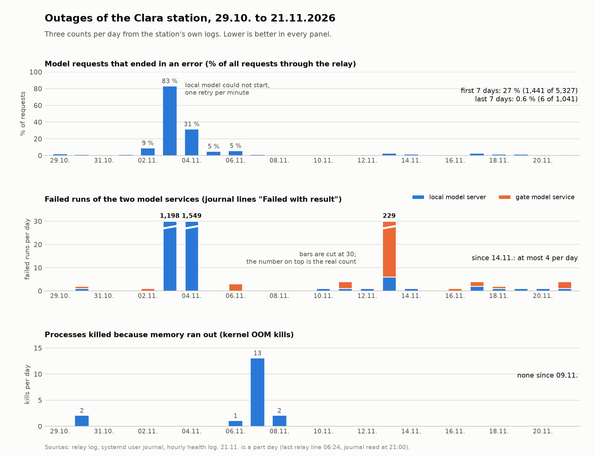
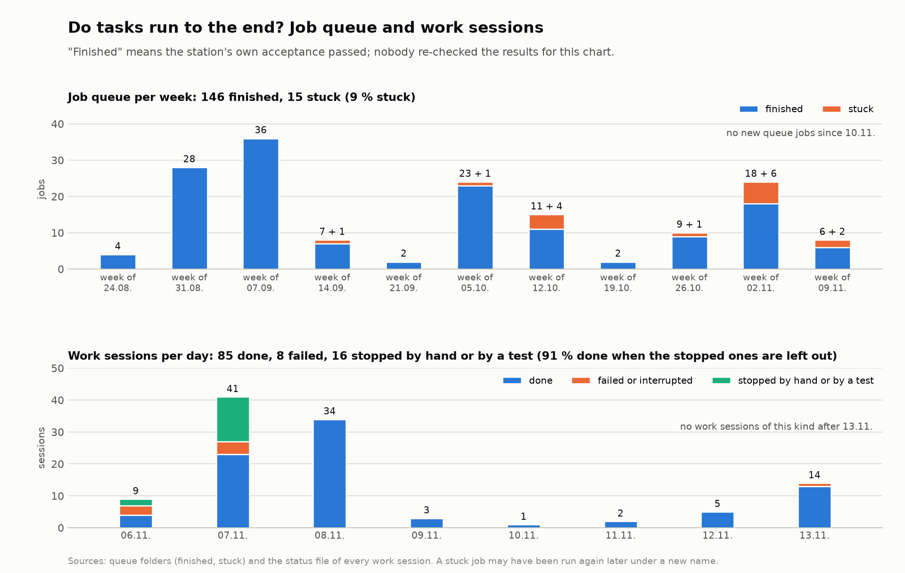
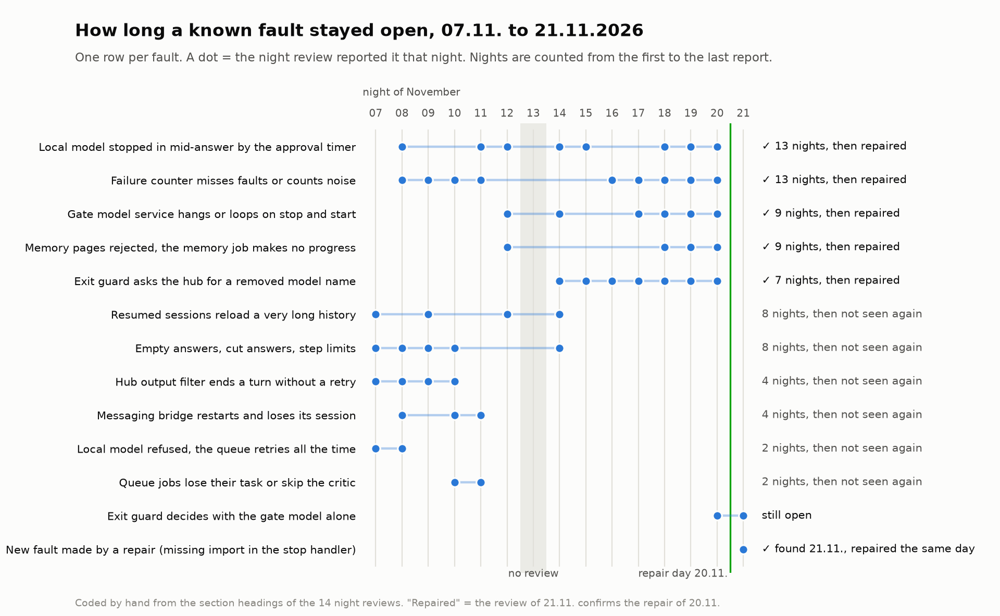
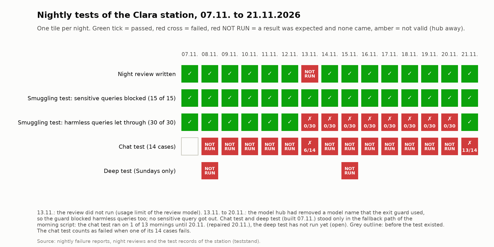
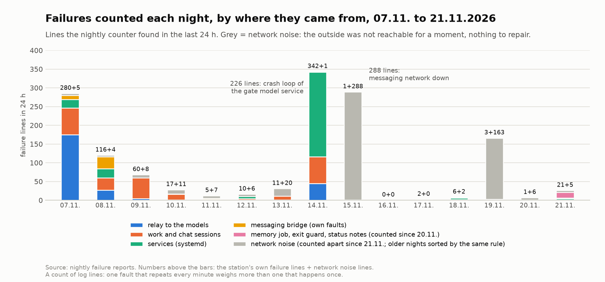
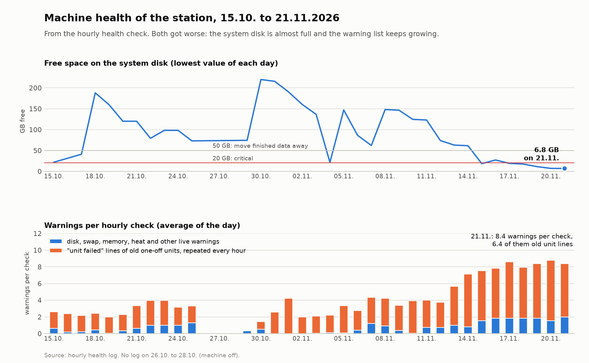
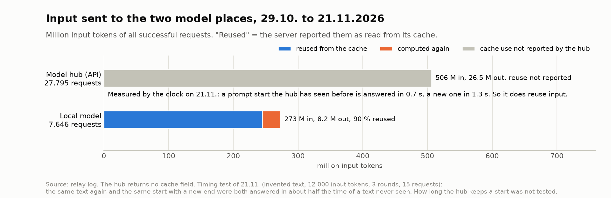
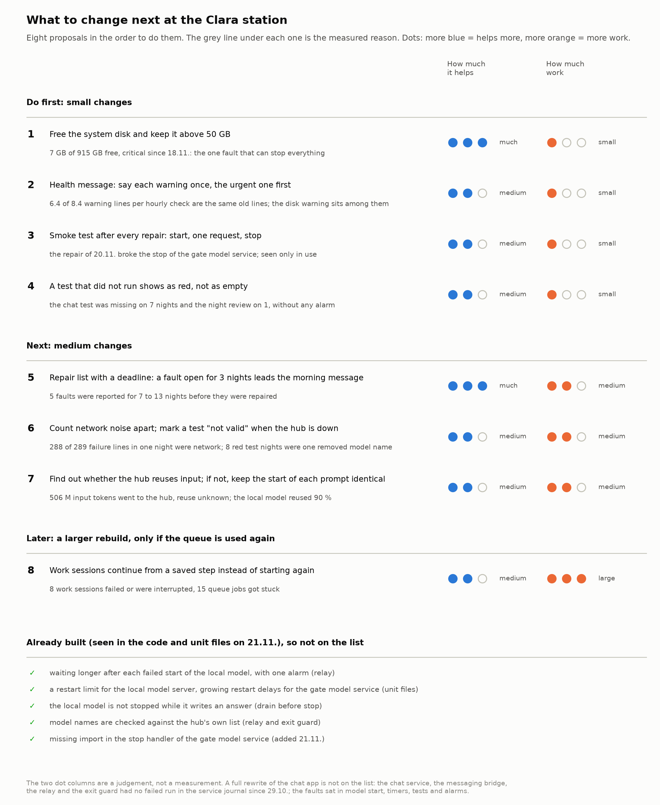

# Three weeks of logs of one agent workstation: request errors fell from 27 % to 0.6 %, the open gaps are a full disk, alarm noise and slow repair

## Aussage
1. **Outages fell sharply.** Model requests through the relay that ended in an error: 27 % in the first 7 days (1,441 of 5,327), 0.6 % in the last 7 days (6 of 1,041), 4.7 % over all 24 days (1,753 of 37,181). The two crash loops of the model services (1,198 and 1,549 failed starts of the local model server on two days, 229 failed runs on a third day, mostly the gate model service) did not come back: since 14.11. there were at most 4 failed runs a day. No process was killed for lack of memory since 09.11. (18 kills from 30.10. to 08.11.). The chat service, the messaging bridge, the relay and the exit guard had no failed run in the service journal in the whole period. Limit: the last week had low load, about 150 requests a day against about 760 a day in the first week.

2. **Most tasks ran to the end.** Job queue: 146 jobs finished, 15 stuck (9 %). Work sessions: 85 done, 8 failed or interrupted, 16 stopped by hand or by a test (91 % done when the stopped ones are left out). "Finished" is the station's own acceptance; nobody re-checked the results for this entry. There were no new queue jobs since 10.11. and no work sessions after 13.11.

3. **The nightly review finds faults fast, the repair was slow.** Five faults were reported for 7 to 13 nights before they were repaired, all on one repair day. One repair of that day made a new fault (a missing import in a stop handler); the review found it the next night and it was repaired the same day. This continues [the entry of 20.11.](agent-system-check-nightly-reports-need-a-build-loop.md).

4. **The tests themselves had gaps.** Over 15 nights the night review was missing once. The chat test was built on 07.11. and expected on 14 mornings since; it ran on 2 and was missing on 12 (a script fault: it stood only in a fallback path), and the weekly deep test, expected on 2 Sundays, never ran. Nothing raised an alarm. *Follow-up 22.11.: the deep test takes about 25 minutes and the morning script allows 20, so it does not fit into the morning run; it now has its own weekly timer two hours before the morning message and reports its state itself (ok, failed, not valid when the hub is away). Its first run is open.* (The first version of this entry said 7 nights; it had taken the first report that contains the test as the day the test was first expected.) The exit-guard test blocked the sensitive queries 15 of 15 on every night. The harmless queries passed 30 of 30 on 7 nights and 0 of 30 on 8 nights: the model hub had removed a model name that the guard used, so the guard blocked everything. Nothing leaked, but for 8 nights the guard was of no use.

5. **The nightly failure count is a count of log lines and swings without meaning** (0 to 343). On one night 288 of 289 lines were network lines of the messaging bridge; on another 226 of 343 came from one crash loop. Sorted by one written rule for "the outside was away for a moment", 526 of the 1,401 lines of the 15 nights are network noise (grey in the chart); since 21.11. the counter lists them in a table of their own.

6. **Two things got worse.** The system disk has 6.8 GB free of 915 GB and has been below the station's own critical limit of 20 GB since 18.11. The hourly health check wrote 8.4 warning lines per check on 21.11.; 6.4 of them are the same "unit failed" lines of old one-off units, repeated every hour. The disk warning sits among them. The chart shows this state. On the evening of 21.11. finished results that were not in use were moved to two archive disks (each move checked file by file before the local copy was removed): 73 GB free.

7. **Local model and hub.** The hub got 506 M input tokens in 27,782 requests, the local model 273 M in 7,646 requests. The local server reported 90 % of its input as read from its cache. The hub returns no cached-token count, so its reuse was unknown, not zero. A timing test on 21.11. answers the question: a prompt of about 12,000 input tokens that the hub had not seen took 1.3 s (median of 3 rounds; the control with another first word), the same prompt again 0.7 s, and the same start with a new last line 0.7 s, in every round. So the hub reuses the start of a prompt and does not report it; what share of the 506 M tokens was reused cannot be read from the log. Over 564 hourly checks the local model was loaded and idle in 30 of them, so idle GPU time is a small loss.

8. **What to change next, in this order, and the state on the evening of 21.11.** (the two dot columns of the chart are a judgement, not a measurement; "tested" means tested on the day it was built, on invented or copied records, not over nights):
   1. Free the system disk and keep it above 50 GB. *Done: 73 GB free.*
   2. Health message: say each warning once, the urgent one first. *Built and tested.*
   3. Smoke test after every repair: start, one request, stop. *Tool built and tested on a probe unit (restart, one request, stop with a clean systemd result and no traceback, start); its first run on the repaired service is open, and the morning message says so.*
   4. A test that did not run shows as red, not as empty. *Built and tested: every expected test has one of four states each morning: ok, failed, not valid, NOT RUN.*
   5. A repair list with a deadline: a fault open for 3 nights leads the morning message. *Built and tested with a print-only run of the morning script; a fault closes after two nights without a sight or is accepted by hand with a reason. The first real morning message is on 22.11.*
   6. Count network noise apart; mark a test "not valid" when the hub is down. *Built and tested with the hub made unreachable for the test.*
   7. Find out whether the hub reuses input; if not, keep the start of each prompt identical. *Answered: it does (point 7 above), so an identical prompt start pays off at the hub as well.*
   8. Later, and only if the queue is used again: work sessions continue from a saved step. *Waits by its own condition.*

   Building proposal 4 found the two wrong numbers corrected in point 4. Building proposal 1 found a fault in the archive tool: folders that were read-only locally were created read-only on a network share and could not be filled; the file-by-file check caught it twice and kept the local copy.

9. **A rewrite of the chat app is not supported by these logs.** The faults sat in model start, timers, tests and alarms, not in the chat service. Waiting longer after each failed model start, a restart limit, the look at the server's slots before a stop and the check of model names against the hub's list are already built.

## Trägt
### Own data
Own read-out on 2026-11-21 of the station's logs: relay log (one line per model request, 2026-10-29 to 2026-11-21 06:24), systemd 255 user journal (lines "Failed with result"), hourly health log (since 2026-10-15), 15 nightly failure reports and 14 night reviews (2026-11-07 to 2026-11-21), status files of the work sessions, folders of the job queue. Counts only. Own timing test of the hub on 2026-11-21 22:26: 3 rounds of 5 requests, invented text (a multiplication table, about 12,400 input tokens, 8 output tokens, temperature 0), each round with a fresh random first word; medians 1.78 s first time, 0.74 s repeated, 0.69 s same start with a new end, 1.29 s other first word. Charts 2, 3, 7 and 8 were redrawn on the evening of 21.11. (network noise apart, tests that did not run in red, the timing result, the state of the proposals); charts 1, 4, 5 and 6 show the read-out of the morning. The fault lifetimes in chart 5 are coded by hand from the section headings of the night reviews. All charts are drawn by a script from one data file.

### Published figures, and how far they compare
| Station | Published figure | Does it compare? |
|---|---|---|
| Request errors 0.6 % in the last week, 27 % in the first | SRE book: no general target; each service picks one below 100 %, the rest is its error budget (99.9 % allows 0.1 % errors) | Fair once a target is written down; the station has none. Against a target of 99 % the last week is inside and the first week 27 times over |
| 6.4 of 8.4 warning lines per check repeat an old state | SRE book ch. 6: "Every page should be actionable" | Fair: the station fails this rule |
| Guard: harmless queries passed 30/30 on 7 nights and 0/30 on 8; sensitive blocked 15/15 | Constitutional Classifiers: +0.38 % refusals on production traffic. InjecGuard: guard models let through between 0.88 % and 99.71 % of 339 benign samples. XSTest: 0.8 % to 38 % of safe prompts fully refused | Fair as a pattern: blocking too much is the known failure of guards. The station's test sets are small; 15 of 15 only shows a true block rate above about 78 % (95 % Clopper-Pearson) |
| 91 % of work sessions done, 9 % of queue jobs stuck | τ-bench: 61 % (retail) and 35 % (airline) of tasks solved in one try. TheAgentCompany: best agent 30 %. MAST: 41 % to 86.7 % failure | Not comparable: benchmark tasks are hard and graded from outside; here the jobs are own routine jobs with own acceptance |
| One review per night by a second model, repair by hand | Pan 2025: 74 % of deployed agents depend mainly on human evaluation; 68 % run at most 10 steps before a human steps in | Context only: the station is in the usual range |
| One repair made a new fault | DORA change failure rate (5 % for the top group; unverified against the primary report) | Not comparable: too few changes counted |
| 779 M input tokens in 24 days, hub reuse shown by timing but not reported | Kapoor 2024: report cost next to accuracy; cost differed almost a hundredfold at similar accuracy | Fair as a rule: the station does not yet report tokens per finished task |

### Sources
Opened on 2026-11-21 by two research agents of the same session; not opened a second time for this entry. No DOI or PMID was seen for any of them; papers carry their arXiv id.

Figures used for the comparison:
- Beyer B, Jones C, Petoff J, Murphy NR (eds.), 2016. *Site Reliability Engineering*. O'Reilly. Chapters 3, 4, 6 and 11, <https://sre.google/sre-book/embracing-risk/>, <https://sre.google/sre-book/monitoring-distributed-systems/>. Verified. A reliability target is chosen per service and is below 100 %; the gap is the error budget; every page should be actionable.
- Yao S, 2024. τ-bench: A Benchmark for Tool-Agent-User Interaction in Real-World Domains. arXiv:2406.12045, <https://arxiv.org/abs/2406.12045>. Verified. A function-calling agent solved 61.2 % (retail) and 35.2 % (airline) of tasks in one try; all of 8 tries succeeded in under 25 % (retail).
- Xu F, 2024. TheAgentCompany: Benchmarking LLM Agents on Consequential Real World Tasks. arXiv:2412.14161, <https://arxiv.org/abs/2412.14161>. Verified. 175 office tasks; the best agent finished 24 % (first version) and 30.3 % (third version).
- Cemri M, 2025. Why Do Multi-Agent LLM Systems Fail? arXiv:2503.13657, <https://arxiv.org/abs/2503.13657>. Partly verified (venue and the per-framework figure: unverified). 14 failure modes in more than 1,600 traces of 7 frameworks; failure between 41 % and 86.7 %.
- Kapoor S, 2024. AI Agents That Matter. arXiv:2407.01502, <https://arxiv.org/abs/2407.01502>. Verified. Cost has to be reported next to accuracy; at similar accuracy cost differed by almost two orders of magnitude.
- Kwa T, 2025. Measuring AI Ability to Complete Long Software Tasks. arXiv:2503.14499, <https://arxiv.org/abs/2503.14499>. Verified; not used for a comparison. The task length that models finish half of the time doubled about every 7 months.
- Pan MZ, 2025. Measuring Agents in Production. arXiv:2512.04123, <https://arxiv.org/abs/2512.04123>. Verified. 306 responses on 86 deployed systems: 68 % run at most 10 steps before a human steps in, 74 % depend mainly on human evaluation.
- Sharma M, 2025. Constitutional Classifiers: Defending against Universal Jailbreaks across Thousands of Hours of Red Teaming. arXiv:2501.18837, <https://arxiv.org/abs/2501.18837>. Verified. Jailbreak success fell from 86 % to 4.4 % at +0.38 % refusals on production traffic.
- Li H, 2024. InjecGuard: Benchmarking and Mitigating Over-defense in Prompt Injection Guardrail Models. arXiv:2410.22770, <https://arxiv.org/abs/2410.22770>. Verified. On 339 benign samples the guard models let through between 0.88 % and 99.71 %.
- Röttger P, 2024. XSTest: A Test Suite for Identifying Exaggerated Safety Behaviours in Large Language Models. NAACL 2024, arXiv:2308.01263, <https://arxiv.org/abs/2308.01263>. Verified. Safe prompts fully refused: 0.8 % to 38 % depending on model and system prompt.
- DORA, 2024. Accelerate State of DevOps Report. Definitions verified at <https://dora.dev/guides/dora-metrics/>; the group thresholds come from a secondary page: unverified.

Techniques behind the proposals:
- Thurgood S et al. *The Site Reliability Workbook*, ch. 5 "Alerting on SLOs", <https://sre.google/workbook/alerting-on-slos/>; ch. 10 "Postmortem Culture", <https://sre.google/workbook/postmortem-culture/>; ch. 16 "Canarying Releases", <https://sre.google/workbook/canarying-releases/>. Verified. Alert on the rate at which the error budget is used; action items need an owner and a checkable end state; most incidents are set off by a change, so a change is tried on a small scale first (proposals 3, 5).
- Prometheus Alertmanager documentation, <https://prometheus.io/docs/alerting/latest/alertmanager/>. Verified. Grouping, inhibition and a repeat interval (default 4 h) keep one state from being sent again and again (proposal 2).
- systemd 255 manual, systemd.service(5) and systemd.unit(5), <https://www.freedesktop.org/software/systemd/man/latest/systemd.service.html>. Verified. `StartLimitIntervalSec=`/`StartLimitBurst=` (default 5 starts in 10 s), `RestartSteps=`, `RestartMaxDelaySec=`, `ExecCondition=`, `OnFailure=`; `systemctl reset-failed` clears an old failed state (proposal 2, and what is already built).
- Kubernetes documentation, "Node-pressure Eviction", <https://kubernetes.io/docs/concepts/scheduling-eviction/node-pressure-eviction/>. Verified. A node starts to evict work below 10 % free disk by default; 6.8 of 915 GB is 0.7 % (proposal 1).
- Anthropic, 2026. Demystifying evals for AI agents, <https://www.anthropic.com/engineering/demystifying-evals-for-ai-agents>. Verified. A pass rate of 0 % is most often a broken task, not an incapable agent; infrastructure failures are kept apart from agent failures (proposals 4, 6; "not valid" is this entry's own wording).
- vLLM documentation, serve CLI reference, <https://docs.vllm.ai/en/latest/cli/serve.html>, and llama.cpp server README, <https://github.com/ggml-org/llama.cpp/blob/master/tools/server/README.md>. Verified. vLLM reports cached tokens only with `--enable-prompt-tokens-details` (default off), so a missing count does not show a missing cache; llama.cpp reuses an identical prompt start by default (proposal 7). Which server the hub runs is not known.
- Anthropic, 2025. Effective harnesses for long-running agents, <https://www.anthropic.com/engineering/effective-harnesses-for-long-running-agents>; Anthropic, 2025. How we built our multi-agent research system (engineering blog). Verified. Progress files and commits let a later session continue from the last finished step (proposal 8).
- Brooker M, 2019. Timeouts, retries, and backoff with jitter. AWS Builders' Library. Fowler M, 2014. CircuitBreaker, <https://martinfowler.com/bliki/CircuitBreaker.html>. Verified. Growing waits with an upper limit and a breaker that opens after repeated failures; the station's relay already does this.
- Chen L, 2023. FrugalGPT. arXiv:2305.05176; Ong I, 2024. RouteLLM. arXiv:2406.18665. Verified; not used. They route by expected difficulty; this station routes by data sensitivity.

### Data tables
Per day. "Failed runs" are journal lines of the two model services; "warnings" are the average per hourly check; 21.11. is a part day.

| Day | Requests | Errors | Error % | Failed runs, local model server | Failed runs, gate model service | Memory kills | Disk free (GB, lowest) | Live warnings | Old "unit failed" lines |
|---|---|---|---|---|---|---|---|---|---|
| 29.10. | 272 | 4 | 1.5 | 0 | 0 | 0 | 74 | 0.3 | 0.1 |
| 30.10. | 796 | 4 | 0.5 | 1 | 1 | 2 | 220 | 0.5 | 0.9 |
| 31.10. | 656 | 3 | 0.5 | 0 | 0 | 0 | 216 | 0.0 | 2.6 |
| 01.11. | 146 | 1 | 0.7 | 0 | 0 | 0 | 190 | 0.0 | 4.2 |
| 02.11. | 152 | 13 | 8.6 | 0 | 1 | 0 | 160 | 0.0 | 2.0 |
| 03.11. | 748 | 619 | 82.8 | 1,198 | 0 | 0 | 136 | 0.0 | 2.0 |
| 04.11. | 2,557 | 797 | 31.2 | 1,549 | 0 | 0 | 21 | 0.1 | 2.1 |
| 05.11. | 1,101 | 50 | 4.5 | 0 | 0 | 0 | 147 | 0.1 | 3.2 |
| 06.11. | 2,486 | 131 | 5.3 | 0 | 3 | 1 | 86 | 0.4 | 2.3 |
| 07.11. | 14,185 | 71 | 0.5 | 0 | 0 | 13 | 62 | 1.2 | 3.1 |
| 08.11. | 4,889 | 4 | 0.1 | 0 | 0 | 2 | 148 | 0.9 | 3.3 |
| 09.11. | 4,190 | 1 | 0.0 | 0 | 0 | 0 | 146 | 0.4 | 3.0 |
| 10.11. | 1,119 | 1 | 0.1 | 1 | 0 | 0 | 124 | 0.0 | 3.9 |
| 11.11. | 281 | 1 | 0.4 | 1 | 3 | 0 | 123 | 0.8 | 3.2 |
| 12.11. | 482 | 1 | 0.2 | 1 | 0 | 0 | 74 | 0.8 | 3.0 |
| 13.11. | 1,981 | 45 | 2.3 | 6 | 223 | 0 | 63 | 1.0 | 4.7 |
| 14.11. | 99 | 1 | 1.0 | 1 | 0 | 0 | 61 | 0.8 | 6.3 |
| 15.11. | 92 | 0 | 0.0 | 0 | 0 | 0 | 18 | 1.5 | 6.0 |
| 16.11. | 95 | 0 | 0.0 | 0 | 1 | 0 | 27 | 1.8 | 6.0 |
| 17.11. | 95 | 2 | 2.1 | 2 | 2 | 0 | 19 | 1.8 | 6.8 |
| 18.11. | 111 | 1 | 0.9 | 1 | 1 | 0 | 17 | 1.8 | 6.1 |
| 19.11. | 93 | 1 | 1.1 | 1 | 0 | 0 | 11 | 1.8 | 6.5 |
| 20.11. | 237 | 1 | 0.4 | 1 | 0 | 0 | 7 | 1.5 | 7.2 |
| 21.11. | 318 | 1 | 0.3 | 1 | 3 | 0 | 7 | 2.0 | 6.4 |

Per night (lines of the nightly failure count by source, then the tests). Network noise is sorted out of the other columns by the rule that the counter uses since 21.11. "NOT RUN" = expected and without a result; "-" = not expected yet (chat test and deep test were built on 07.11.; the deep test is expected on Sundays).

| Night | Failure lines | Relay | Sessions | Services | Messaging bridge | Memory job, guard, notes (since 20.11.) | Network noise | Review written | Sensitive blocked | Harmless let through | Chat test | Deep test |
|---|---|---|---|---|---|---|---|---|---|---|---|---|
| 07.11. | 285 | 175 | 71 | 23 | 11 | 0 | 5 | yes | 15/15 | 30/30 | - | - |
| 08.11. | 120 | 27 | 33 | 24 | 32 | 0 | 4 | yes | 15/15 | 30/30 | NOT RUN | NOT RUN |
| 09.11. | 68 | 4 | 56 | 0 | 0 | 0 | 8 | yes | 15/15 | 30/30 | NOT RUN | - |
| 10.11. | 28 | 1 | 15 | 0 | 1 | 0 | 11 | yes | 15/15 | 30/30 | NOT RUN | - |
| 11.11. | 12 | 1 | 2 | 0 | 2 | 0 | 7 | yes | 15/15 | 30/30 | NOT RUN | - |
| 12.11. | 16 | 1 | 3 | 6 | 0 | 0 | 6 | yes | 15/15 | 30/30 | NOT RUN | - |
| 13.11. | 31 | 1 | 10 | 0 | 0 | 0 | 20 | no | 15/15 | 0/30 | 6/14 | - |
| 14.11. | 343 | 45 | 71 | 226 | 0 | 0 | 1 | yes | 15/15 | 0/30 | NOT RUN | - |
| 15.11. | 289 | 1 | 0 | 0 | 0 | 0 | 288 | yes | 15/15 | 0/30 | NOT RUN | NOT RUN |
| 16.11. | 0 | 0 | 0 | 0 | 0 | 0 | 0 | yes | 15/15 | 0/30 | NOT RUN | - |
| 17.11. | 2 | 0 | 0 | 2 | 0 | 0 | 0 | yes | 15/15 | 0/30 | NOT RUN | - |
| 18.11. | 8 | 2 | 0 | 4 | 0 | 0 | 2 | yes | 15/15 | 0/30 | NOT RUN | - |
| 19.11. | 166 | 1 | 0 | 2 | 0 | 0 | 163 | yes | 15/15 | 0/30 | NOT RUN | - |
| 20.11. | 7 | 1 | 0 | 0 | 0 | 0 | 6 | yes | 15/15 | 0/30 | NOT RUN | - |
| 21.11. | 26 | 1 | 0 | 3 | 2 | 15 | 5 | yes | 15/15 | 30/30 | 13/14 | - |

Job queue per week (Monday).

| Week of | Finished | Stuck |
|---|---|---|
| 24.08. | 4 | 0 |
| 31.08. | 28 | 0 |
| 07.09. | 36 | 0 |
| 14.09. | 7 | 1 |
| 21.09. | 2 | 0 |
| 05.10. | 23 | 1 |
| 12.10. | 11 | 4 |
| 19.10. | 2 | 0 |
| 26.10. | 9 | 1 |
| 02.11. | 18 | 6 |
| 09.11. | 6 | 2 |

Work sessions per day.

| Day | Done | Failed or interrupted | Stopped by hand or test |
|---|---|---|---|
| 06.11. | 4 | 3 | 2 |
| 07.11. | 23 | 4 | 14 |
| 08.11. | 34 | 0 | 0 |
| 09.11. | 3 | 0 | 0 |
| 10.11. | 1 | 0 | 0 |
| 11.11. | 2 | 0 | 0 |
| 12.11. | 5 | 0 | 0 |
| 13.11. | 13 | 1 | 0 |

## Trägt nicht
One workstation, 24 days. The low error rate of the last week was measured under low load and without queue jobs; it is not yet shown under the load of the first week. "Finished" and "done" are the station's own acceptance. The fault lifetimes are hand-coded and count from the first to the last report, so a fault that was not named on one night still counts as open. The ranking of the proposals is a judgement. That the hub reuses input rests on one timing test of 15 requests on one evening; how long it keeps a prompt start and what share of its input was reused are not known. The changes of 21.11. were tested on the day they were built; whether they shorten the time to repair is not measured yet. The published figures come from benchmarks and surveys with other tasks; only the rows marked "fair" in the table are a yardstick.

## Bruchindikator
More than 1 % request errors in a week with queue jobs running; more than 30 failed starts of a model service in a day; the system disk below 20 GB again after it was freed; a fault named in three night reviews in a row; a test missing from a nightly report without an alarm.

## Ablesung
Write down a target for the request error rate before judging it. Count failures by cause, not by log line. Treat a test that did not run, and a test that failed because its backend was away, as states of their own. After every repair run the smallest end-to-end test before the repair counts as done. Watch free disk as its own alarm, not as one line among repeated ones.
