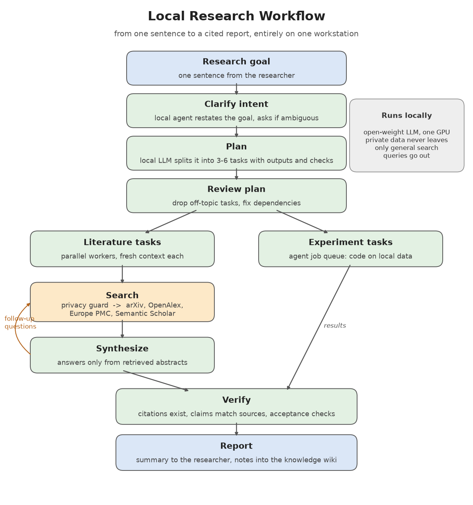

# Lokaler Rechercheschwarm: erster Lauf vom einen Satz bis zum Bericht

## Aufbau
Nutzer schreibt dem lokalen Agenten einen Satz. Agent ruft `plane "<Satz>" --schwarm 3` (Skill `ziele-planen`,
Regel im geladenen Gedaechtnis). Das 27B plant 3-6 Auftraege, ein zweiter Durchgang prueft den Plan.
Recherche-Auftraege erledigen drei parallele Arbeiter (`schwarm`): Suchfragen -> Waechter -> offene
Literatur-APIs -> Antwort aus Abstracts -> Abschnitt mit Quellen -> Selbstabnahme. Messauftraege gehen in den dauerlauf.

## Gemessen (ein Lauf, 4 Rechercheauftraege)
| Groesse | Wert |
|---|---|
| Satz bis Plan eingereiht | ca. 4 min |
| drei Arbeiter parallel fertig | 13-20 min |
| alle vier Recherchen inkl. Synthese | 30 min |
| Suchfragen beantwortet | 19 von 20 (1 vom Waechter gesperrt: Pruefmodell im Zeitzaun) |
| zitierte DOIs im DOI-Register vorhanden | 64 von 64 |
| Abnahme | 4 von 4 im ersten Anlauf |

## Lehren
- **Faehigkeit im richtigen Profil ablegen.** Der Agent lief im Profil `projekt`, die Fertigkeit lag im Standardprofil:
  zweimal recherchierte er im Chat selbst. Erst Verlinkung ins Profil plus EIN Eintrag im wirklich geladenen
  Gedaechtnis (`memories/MEMORY.md`, nicht `MEMORY.md` im Profilwurzelverzeichnis) brachten den Aufruf.
- **Lesart ist die groesste Fehlerquelle.** Der Agent hat das Ziel umformuliert und eigene Projektthemen hineingelesen.
  Inhalt und Quellen waren sauber, die Frage womoeglich die falsche. Naechster Schritt: Satz woertlich weitergeben,
  bei Mehrdeutigkeit Lesarten nennen.
- **Ein Modellplatz ist der Engpass.** Abfragen laufen parallel, Modellschritte warten; dadurch lief die
  Waechterpruefung einmal in den Zeitzaun und sperrte (richtig, aber verlustreich).
- **Planpruefung kann an kaputtem JSON scheitern** (einmal); jetzt mit einem Reparaturversuch.
- Planpruefung erkennt Abschweifungen und tote Verweise, aber keine Sachfehler (Plan wollte Gefaessmasken aus SynthSeg).

## Offene Schritte (siehe Bild)
Nachfass-Schleife je Arbeiter, automatischer Zitatpruefer (DOI-Register, Aussage gegen Abstract), Bericht an den Nutzer
per Telegram, Auswertung ueber viele Laeufe.

## Nachtrag 2026-10-09 abends: Uebergabe als Standard
Nutzerregel: Aufgaben gehen an den lokalen Agenten, wenn er arbeiten kann; sonst erledigt sie die Cloud-Sitzung.
Werkzeug `weiterreichen --pruefen` (Modell antwortet, keine GPU-Sperre, dauerlauf aktiv), dann `weiterreichen "<Ziel>"`
(planen + einreihen), `--schwarm` (Recherche), `--direkt` (kurzes Gespraech) oder `--datei` (fertiger Auftrag mit Abnahme).
Stand des Tages: 11 Auftraege in Folge ohne Eingriff, alle in Runde 2 abgenommen, keiner in Runde 1.
