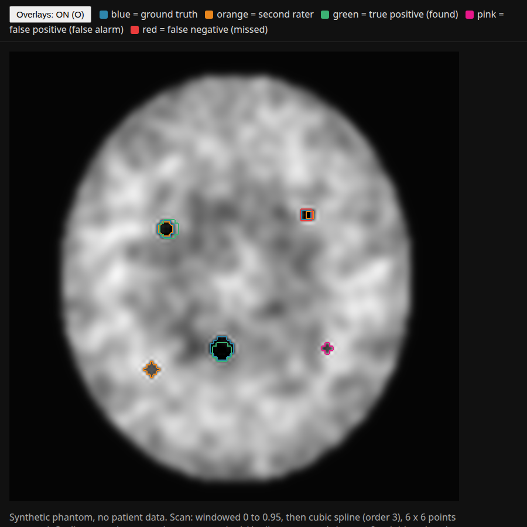

# Masks over an MRI slice: blue ground truth, orange second rater, green found, pink false alarm, red missed; window, cubic upsampling, PNG

## Aussage
1. **Five roles, five colours, on every page, figure and film frame:** ground truth (reference, rater 1) **blue**
   (46, 134, 171); second rater **orange** (232, 135, 30); true positive **green** (59, 178, 115); false positive
   **pink** (232, 23, 138); false negative **red** (235, 60, 60). The colours are never reused for something else; a
   layer that is none of the five gets a sixth colour and its own legend line.
2. **A legend with words** on every picture: colour name = role. Never colour alone.
3. **Outlines, not fills**, as a separate transparent picture, so that the lesion stays visible and the switch
   "Overlays: ON/OFF (O)" hides them all.
4. **Picture quality:** window first, then enlarge with a cubic spline (order 3) in the generator, at least 3 points
   per voxel, main view at least 768 points wide; masks are enlarged by repeating voxels, never smoothed; counts and
   volumes are computed on the native voxels; lossless PNG, no JPEG; shown at its own size.
5. **This replaces yellow for false alarms.** The shared viewer generator
   [qc_slice_viewer](../../../tools/mri/mri_segmentation/qc_slice_viewer/README.md) draws the house colours since
   2026-11-24 (user decision of that day): reference blue (46, 134, 171), found green, false alarm pink, missed red,
   grey sheet as lossless PNG, windowed first and enlarged with a cubic spline, 768 points wide. Older entries of this
   area that say yellow or the blue (66, 150, 255) describe the generator before that day. Pages already delivered
   are not recoloured. Not yet adapted in the generator: the CSF layer `csf_drop_tp` (magenta) and the run palette
   of the mode without verdict, which can come close to a house colour.
6. The rule is packed as an Agent Skill with code:
   [tools/skills/mri-overlay-pages](../../../tools/skills/mri-overlay-pages/README.md) (`overlay.py`: colour table,
   verdict by touching clusters, windowed cubic upsampling, outline PNG, legend; `cubic_up.js` for pages that carry the
   raw slices).

*Synthetic phantom, every value invented, no scan; made with `overlay.py --demo` on 2026-11-24.*

## Trägt
- User rule 2026-11-24 for the colour names and roles, and for PNG in the quality of the reworked trainers.
- Own test 2026-11-24 on a synthetic phantom (no scan): demo page looked at as a screenshot and as enlarged crops,
  all five roles readable, outlines crisp, switch works. numpy 2.4.6 (<https://numpy.org>), scipy 1.17.1
  (`ndimage.zoom`, order 3, <https://docs.scipy.org/doc/scipy/reference/generated/scipy.ndimage.zoom.html>),
  Pillow 13.0.0 (<https://pillow.readthedocs.io>), Chromium headless.
- Browser-side cubic upsampling: `cubicUp` from the public WMH trainer, MIT, commit 06e8190
  (<https://github.com/mendeltem/wmh_trainer>), own build 2026-11-23/24.
- Window first and PNG: [qc-slice-images-png-window-aspect](qc-slice-images-png-window-aspect.md).

## Trägt nicht
Not tested on a real scan yet. The exact RGB values of red and blue and the placing of the outlines (rater marks as a
ring inside the mask, verdicts as a ring around it, the second rater one step further in on a shared lesion) were
chosen by the author of the skill, not by the user. Pink and red are close for some colour-vision deficiencies; the
legend words and the different ring positions carry the difference, this was not tested with affected readers.
PNG makes pages larger than JPEG.

## Bruchindikator
A rater confuses pink and red on a real page; a one-voxel lesion disappears under its ring at the usual scale; the
user names other colours.

## Ablesung
Take the colours from `COL` in `overlay.py`, never from memory. Before delivery: screenshot of the page, an enlarged
crop of a small lesion, and a check that every role on the page is in the legend.
